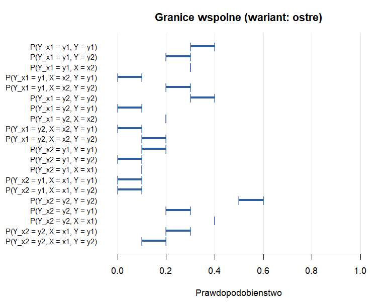

<!-- README.md powstaje z README.Rmd. Zmiany wprowadza się w README.Rmd,
a następnie renderuje plik poleceniem devtools::build_readme(). -->

# CausalBoundsR

[](https://github.com/michaljanus-student/casual-bonds-r/actions/workflows/R-CMD-check.yaml)

Pakiet języka R do wyznaczania granic prawdopodobieństw przyczynowości
dla zabiegu i wyniku o wielu poziomach. Pakiet łączy rozkład
obserwacyjny z rozkładami interwencyjnymi i zwraca dolną oraz górną
granicę prawdopodobieństwa zdarzenia z wynikiem hipotetycznym, wraz z
granicami warunkowymi i wskazaniem twierdzenia, z którego pochodzi wzór.
Pakiet udostępnia dwa warianty wzorów: jawne granice Li i Pearla (2024)
oraz ostre granice w postaci zamkniętej Shu, Wanga i Li (2026).

Projekt dyplomowy na kierunku elektroniczne przetwarzanie informacji,
Instytut Studiów Informacyjnych Uniwersytetu Jagiellońskiego. Promotor:
dr Marek Deja.

## Problem badawczy

Średni efekt zabiegu w populacji odpowiada na pytanie, jak zmieni się
odsetek sukcesów po wprowadzeniu zabiegu. Pytanie o przyczynę wyniku
konkretnej osoby ma inną postać: czy szkolenie było konieczne, aby osoba
znalazła pracę, albo czy osoba bez szkolenia znalazłaby pracę po udziale
w nim. Odpowiedź wymaga wyniku hipotetycznej interwencji u osoby, której
wynik obserwowany jest znany.

Wyniki tej samej osoby przy różnych zabiegach nie są obserwowane
jednocześnie. Dane eksperymentalne i obserwacyjne wyznaczają więc
przedział wartości prawdopodobieństwa przyczynowości zgodnych z danymi.
Szerokość przedziału opisuje niepełną identyfikację wielkości i ma inne
znaczenie niż błąd standardowy oszacowania.

Klasyczne granice Tiana i Pearla (2000) dotyczą zabiegu i wyniku
binarnego. Badania społeczne często mają zabieg o kilku poziomach (na
przykład trzy formy szkolenia) i wynik porządkowy (na przykład brak
pracy, praca tymczasowa, praca stała). Pakiet rozróżnia cztery rodzaje
zdarzeń z jednym wynikiem hipotetycznym, sprawdza spójność tablic i
podaje warunki, przy których granica warunkowa nie istnieje.

## Metoda

Zabieg $X$ ma poziomy $x_1, \ldots, x_m$, a wynik $Y$ poziomy
$y_1, \ldots, y_n$. Rozkład obserwacyjny i rozkłady interwencyjne
zapisuje się w dwóch tablicach $m \times n$:

$$
o_{ji} = P(X = x_j, Y = y_i), \qquad a_{ji} = P(Y_{x_j} = y_i).
$$

Symbol $Y_{x_j}$ oznacza wynik po hipotetycznym ustawieniu zabiegu na
$x_j$. Rozkłady brzegowe obserwacji to
$u_j = \sum_i o_{ji} = P(X = x_j)$ oraz
$v_i = \sum_j o_{ji} = P(Y = y_i)$. Wynik obserwowany jest wynikiem
potencjalnym dla faktycznie otrzymanego zabiegu, co daje warunek
zgodności

$$
o_{ji} \le a_{ji} \le o_{ji} + 1 - u_j .
$$

Warunek wynika z rozbicia $P(Y_{x_j} = y_i)$ na grupę, która otrzymała
zabieg $x_j$ (masa $o_{ji}$), i pozostałe grupy (masa najwyżej
$1 - u_j$). Tablice naruszające warunek nie pochodzą z żadnego modelu
przyczynowego.

**Zachowanie wyniku.** Prawdopodobieństwo, że po ustawieniu zabiegu na
$x_j$ wynik pozostanie równy obserwowanemu $y_i$:

$$
P(Y_{x_j} = y_i, Y = y_i) \le \min\{a_{ji},\ v_i\}.
$$

Dolna granica w wariancie artykułu (Li i Pearl, 2024, tw. 4) wynosi
$\max\{o_{ji},\ a_{ji} + v_i - 1\}$. Wariant ostry (Shu, Wang i Li,
2026, tw. 4) stosuje ograniczenie Frécheta w grupie, która nie otrzymała
zabiegu $x_j$:

$$
L = \max\{o_{ji},\ a_{ji} + v_i - 1 + u_j - o_{ji}\}.
$$

Składnik $u_j - o_{ji}$ jest nieujemny, więc granica ostra jest nie
niższa od granicy artykułu. Dla $o = ((0{,}3;\ 0{,}2), (0{,}1;\ 0{,}4))$
i $a_{11} = 0{,}8$ wariant artykułu daje przedział $[0{,}3;\ 0{,}4]$, a
wariant ostry wartość $0{,}4$: każda osoba z grupy $x_2$ ma wtedy
$Y_{x_1} = y_1$.

**Zastąpienie wyniku.** Prawdopodobieństwo, że obserwowany wynik $y_k$
zostałby zastąpiony przez $y_i$, $i \ne k$:

$$
P(Y_{x_j} = y_i, Y = y_k) \le \min\{a_{ji} - o_{ji},\ v_k - o_{jk}\}.
$$

Dolna granica w wariancie artykułu (tw. 5) wynosi

$$
\max\Bigl\{0,\ a_{ji} + v_k - 1,\ \sum_{p \ne j}
\max\{0,\ a_{ji} + o_{pk} - 1 + u_j - o_{ji}\}\Bigr\},
$$

a w wariancie ostrym

$$
L = \max\{0,\ a_{ji} - o_{ji} + u_j + v_k - o_{jk} - 1\}.
$$

Zdarzenie dotyczy wyłącznie osób spoza grupy $x_j$, ponieważ w grupie
$x_j$ wynik obserwowany jest równy $Y_{x_j}$. Wariant ostry stosuje
ograniczenie Frécheta do całej tej części populacji naraz. Dla dwóch
poziomów zabiegu lub dwóch poziomów wyniku oba warianty dają te same
granice.

**Zmiana zabiegu.** Wynik interwencji w grupie, która otrzymała zabieg
$x_p$, $p \ne j$ (oba warianty, tw. 6 i tw. 3):

$$
\max\{0,\ a_{ji} - o_{ji} - 1 + u_j + u_p\} \le
P(Y_{x_j} = y_i, X = x_p) \le \min\{a_{ji} - o_{ji},\ u_p\}.
$$

**Wynik hipotetyczny w grupie.** Wynik interwencji w grupie o
obserwowanym zabiegu $x_p$ i wyniku $y_k$, $p \ne j$ (oba warianty, tw.
7 i tw. 5):

$$
\max\{0,\ a_{ji} + o_{pk} - 1 + u_j - o_{ji}\} \le
P(Y_{x_j} = y_i, X = x_p, Y = y_k) \le \min\{a_{ji} - o_{ji},\ o_{pk}\}.
$$

Wielkość jest uogólnionym prawdopodobieństwem konieczności. Binarne
prawdopodobieństwo konieczności (PN) i wystarczalności (PS) to wybory
indeksów, po podzieleniu przez $o_{pk}$.

**Granice warunkowe.** Granice prawdopodobieństwa warunkowego powstają
przez podzielenie granic wspólnych przez prawdopodobieństwo zdarzenia
warunkującego: $v_i$, $v_k$, $u_p$ albo $o_{pk}$. Przy zerowym
mianowniku granice warunkowe nie istnieją; pakiet zwraca `NA` ze
statusem `zerowe_warunkowanie` i zachowuje granice wspólne. Dla $p = j$
zgodność wyznacza wartość punktowo, na przykład
$P(Y_{x_j} = y_i, X = x_j) = o_{ji}$.

**PNS dla dwóch poziomów zabiegu.** Prawdopodobieństwo konieczności i
wystarczalności $P(Y_{x_j} = y_i, Y_{x_p} = y_k)$ ma granice

$$
L = \max\{0,\ a_{ji} + a_{pk} - 1,\ L_{pk,ji} + L_{ji,pk}\}, \qquad
U = \min\{a_{ji},\ a_{pk},\ U_{pk,ji} + U_{ji,pk}\},
$$

gdzie $L_{ji,pk}$ i $U_{ji,pk}$ są granicami zdarzenia
$P(Y_{x_j} = y_i, X = x_p, Y = y_k)$. Obliczenie dzieli populację według
faktycznie otrzymanego zabiegu: w każdej z dwóch grup jeden z wyników
potencjalnych jest obserwowany. Dla $m = 2$ granice twierdzenia 8 Li i
Pearla pokrywają się z ostrymi granicami twierdzenia 2 Shu, Wanga i Li.

**Obliczenie.** Pojedyncze zdarzenie wymaga $O(m)$ operacji. Funkcja
`granice_wszystkie()` wyznacza wszystkie $mn + mn(n-1) + mn(m-1) +
mn^2(m-1)$ zdarzeń, co daje koszt $O(m^2 n^2)$. Granice z tablic
oszacowanych z próby nie mają automatycznie poziomu ufności; pakiet
traktuje tablice jako znane rozkłady.

## Procedura generowania danych

Funkcja `generuj_model()` tworzy pełny rozkład stanów
$s = (X, Y_{x_1}, \ldots, Y_{x_m})$. Stanów jest $m n^m$, dla
$m = n = 3$ jest ich 81. Masy stanów są losowane niezależnie:

$$
g_s \sim \operatorname{Gamma}(\kappa, 1), \qquad
\pi_s = \frac{g_s}{\sum_t g_t},
$$

co daje rozkład Dirichleta o parametrze $\kappa$ na zbiorze stanów
(domyślnie $\kappa = 2$, ziarno 202701). Wynik obserwowany jest wynikiem
potencjalnym dla otrzymanego zabiegu, $Y = Y_X$. Z rozkładu stanów
wynikają dokładnie

$$
o_{ji} = \sum_{s:\ X = x_j,\ Y_{x_j} = y_i} \pi_s, \qquad
a_{ji} = \sum_{s:\ Y_{x_j} = y_i} \pi_s,
$$

oraz wartość prawdziwa każdego zdarzenia, na przykład
$P(Y_{x_j} = y_i, X = x_p, Y = y_k) =
\sum_{s:\ Y_{x_j} = y_i,\ X = x_p,\ Y_{x_p} = y_k} \pi_s$. Granice
wyznaczone z dokładnych tablic muszą zawierać wartość prawdziwą; testy
sprawdzają tę własność dla każdego zdarzenia w obu wariantach.

Masy o kształcie $\kappa = 2$ są do siebie zbliżone, więc dolne granice
zwykle przyjmują wartości trywialne ($0$ albo $o_{ji}$). Kształt
$\kappa = 0{,}3$ skupia masę na nielicznych stanach i uruchamia
nietrywialne gałęzie wzorów, a ustawienie $m = 2$ daje model dla granic
PNS z wartością prawdziwą każdego zdarzenia
$P(Y_{x_j} = y_i, Y_{x_p} = y_k)$.

Funkcja losuje też dwie próby po `liczebnosc` jednostek (domyślnie
5000): obserwacyjną, z wynikiem $Y = Y_X$, oraz eksperymentalną, w
której zabieg jest przydzielony losowo z równymi prawdopodobieństwami.
Częstości z prób przybliżają $o$ i $a$ z błędem losowym, więc mogą
naruszać warunek zgodności.

## Instalacja

``` r
# install.packages("remotes")
remotes::install_github("michaljanus-student/casual-bonds-r")
```

## Przykład

Tablice przykładu kontrolnego: dwa poziomy zabiegu, wynik korzystny w
drugiej kolumnie.

``` r
library(CausalBoundsR)

dane <- przygotuj_rozklady(tablice_kontrolne$obserwacje,
                           tablice_kontrolne$interwencje)
dane
#> Rozklad obserwacyjny P(X = x, Y = y):
#>     y1  y2
#> x1 0.3 0.2
#> x2 0.1 0.4
#> 
#> Rozklady interwencyjne P(Y_x = y), wiersz = ustawiony zabieg:
#>     y1  y2
#> x1 0.6 0.4
#> x2 0.2 0.8
#> 
#> P(X): x1 = 0.5, x2 = 0.5 
#> P(Y): y1 = 0.4, y2 = 0.6 
#> Warunek zgodnosci o <= a <= o + 1 - u: spelniony
```

Prawdopodobieństwo konieczności: porażka przy $x_1$ w grupie, która
otrzymała $x_2$ i odniosła sukces.

``` r
granice_zdarzenia(dane, "grupa", wynik = "y1", zabieg = "x1",
                  wynik_obserwowany = "y2", zabieg_obserwowany = "x2",
                  warunkowe = TRUE)
#> Granice prawdopodobienstw przyczynowosci (wariant: ostre)
#>   zabieg: x1, x2
#>   wynik:  y1, y2
#> 
#>                      zdarzenie dolna gorna       status
#>   P(Y_x1 = y1, X = x2, Y = y2)   0.2  0.30 zdefiniowana
#>  P(Y_x1 = y1 | X = x2, Y = y2)   0.5  0.75 zdefiniowana
#> 
#> Zrodlo wzoru: Shu, Wang i Li (2026), tw. 5 (PN)
```

Prawdopodobieństwo konieczności i wystarczalności:

``` r
granice_pns(dane, wynik_po = "y2", wynik_bez = "y1")
#> Granice prawdopodobienstw przyczynowosci (wariant: ostre)
#>   zabieg: x1, x2
#>   wynik:  y1, y2
#> 
#>                zdarzenie dolna gorna       status
#>  P(Y_x2 = y2, Y_x1 = y1)   0.4   0.6 zdefiniowana
#> 
#> Zrodlo wzoru: Shu, Wang i Li (2026), tw. 2 (PNS)
```

Różnica wariantów na tablicach, w których wariant artykułu nie osiąga
granicy ostrej ($a_{11} = 0{,}8$):

``` r
poziomy <- list(c("x1", "x2"), c("y1", "y2"))
o <- matrix(c(0.3, 0.1, 0.2, 0.4), 2, dimnames = poziomy)
a <- matrix(c(0.8, 0.2, 0.2, 0.8), 2, dimnames = poziomy)
inne <- przygotuj_rozklady(o, a)
granice_zdarzenia(inne, "zachowanie", wynik = "y1", zabieg = "x1",
                  wariant = "artykul")
#> Granice prawdopodobienstw przyczynowosci (wariant: artykul)
#>   zabieg: x1, x2
#>   wynik:  y1, y2
#> 
#>             zdarzenie dolna gorna       status
#>  P(Y_x1 = y1, Y = y1)   0.3   0.4 zdefiniowana
#> 
#> Zrodlo wzoru: Li i Pearl (2024), tw. 4
granice_zdarzenia(inne, "zachowanie", wynik = "y1", zabieg = "x1")
#> Granice prawdopodobienstw przyczynowosci (wariant: ostre)
#>   zabieg: x1, x2
#>   wynik:  y1, y2
#> 
#>             zdarzenie dolna gorna       status
#>  P(Y_x1 = y1, Y = y1)   0.4   0.4 zdefiniowana
#> 
#> Zrodlo wzoru: Shu, Wang i Li (2026), tw. 4 (PRep)
```

Model o znanej wartości prawdziwej z trzema poziomami zabiegu i wyniku:
granice z dokładnych tablic zawierają wartość prawdziwą każdego z 99
zdarzeń.

``` r
model <- generuj_model(liczebnosc = 2000, ksztalt = 0.3)
granice <- granice_wszystkie(model$rozklady)
porownanie <- merge(granice$przedzialy, model$prawda,
                    by = c("zdarzenie", "rodzaj"))
mean(porownanie$wartosc >= porownanie$dolna &
       porownanie$wartosc <= porownanie$gorna)
#> [1] 1
summary(granice)
#> Granice prawdopodobienstw przyczynowosci (wariant: ostre)
#> Poziomy zabiegu: 3, poziomy wyniku: 3
#> 
#>          rodzaj granice liczba szer_srednia szer_maks nieokreslone
#>           grupa wspolne     54       0.1100    0.1960            0
#>      zachowanie wspolne      9       0.1988    0.2879            0
#>     zastapienie wspolne     18       0.1965    0.3154            0
#>  zmiana_zabiegu wspolne     18       0.2042    0.3303            0
#> 
#> Statusy:
#> 
#> zdefiniowana 
#>           99
```

Wszystkie zdarzenia z jednym wynikiem hipotetycznym dla tablic przykładu
kontrolnego:

``` r
plot(granice_wszystkie(dane))
```



## Struktura pakietu

| Plik | Zawartość |
|----|----|
| `R/rozklady.R` | `przygotuj_rozklady()`: dopasowanie poziomów, rozkłady brzegowe, diagnostyka zgodności |
| `R/granice_jawne.R` | `granice_zdarzenia()`, `granice_wszystkie()`: wzory czterech rodzajów zdarzeń w obu wariantach |
| `R/pns.R` | `granice_pns()`: PNS dla dwóch poziomów zabiegu |
| `R/generator.R` | `generuj_model()`: rozkład stanów, dokładne tablice, wartości prawdziwe, próby |
| `R/metody_s3.R` | metody `print()`, `summary()` i `plot()` klasy `granice_przyczynowe` oraz wydruk rozkładów i modelu |
| `R/dane.R` | dokumentacja zbioru `tablice_kontrolne` |
| `data-raw/generuj_dane.R` | skrypt tworzący zbiór przykładowy |
| `tests/testthat/` | testy analityczne, testy własności, kontrola programem liniowym, prawda z generatora, kontrakt błędów |
| `vignettes/` | poradnik oraz strony serwisu: algorytm i nota o serwisie |

## Weryfikacja

Testy pakietu mają trzy warstwy. **Przypadki analityczne** porównują
wynik z wartościami policzonymi ręcznie, z rachunkiem zapisanym w
komentarzu testu: w przykładzie kontrolnym prawdopodobieństwo
konieczności ma granice wspólne $[0{,}2;\ 0{,}3]$ i warunkowe
$[0{,}5;\ 0{,}75]$, prawdopodobieństwo wystarczalności $[0{,}2;\ 0{,}3]$
i $[2/3;\ 1]$, a PNS $[0{,}4;\ 0{,}6]$. Przypadki obejmują też
kontrprzykłady do ostrości twierdzeń 4 i 5 artykułu Li i Pearla, zerowe
warunkowanie oraz deterministyczny model z PNS równym 1.

**Testy własności** sprawdzają warunki niezależne od danych: granice w
przedziale $[0, 1]$, zawieranie się granic ostrych w granicach artykułu,
równość granic górnych obu wariantów, zgodność granic warunkowych z
wspólnymi i niezależność wyniku od kolejności poziomów przy dopasowaniu
po nazwach.

**Kontrola niezależną metodą** rozwiązuje program liniowy po typach
odpowiedzi (Balke) dla losowych tablic $2 \times 2$, $2 \times 3$,
$3 \times 2$ i $3 \times 3$. Wariant ostry daje dokładnie granice
programu liniowego, a przedział wariantu artykułu zawiera je. **Prawda z
generatora** wymaga, aby granice z dokładnych tablic zawierały wartość
prawdziwą każdego zdarzenia.

Testy kontraktu błędów opisują reakcję na tablice o niezgodnych
poziomach, prawdopodobieństwa spoza $[0, 1]$, rozkłady niesumujące się
do jedności i sprzeczne marginesy.

``` r
devtools::test()
devtools::check()
```

## Literatura

Li, A., Pearl, J. (2024). Probabilities of causation with nonbinary
treatment and effect. *Proceedings of the AAAI Conference on Artificial
Intelligence*, 38(18), 20465–20472.
<https://doi.org/10.1609/aaai.v38i18.30030>

Shu, X., Wang, S., Li, A. (2026). Identification of probabilities of
causation: from recursive to closed-form bounds. *Proceedings of the
Thirty-Fifth International Joint Conference on Artificial Intelligence*,
4063–4070. <https://doi.org/10.24963/ijcai.2026/452>

Shu, X., Li, A. (2026). Unified sharp bounds on probabilities of
causation. Preprint arXiv:2610.27398.
<https://arxiv.org/abs/2610.27398v1>

Tian, J., Pearl, J. (2000). Probabilities of causation: bounds and
identification. *Annals of Mathematics and Artificial Intelligence*, 28,
287–313. <https://doi.org/10.1023/A:1018912507879>

## Licencja

GPL-3.
